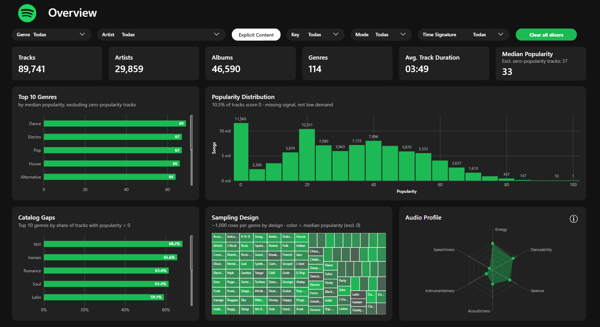
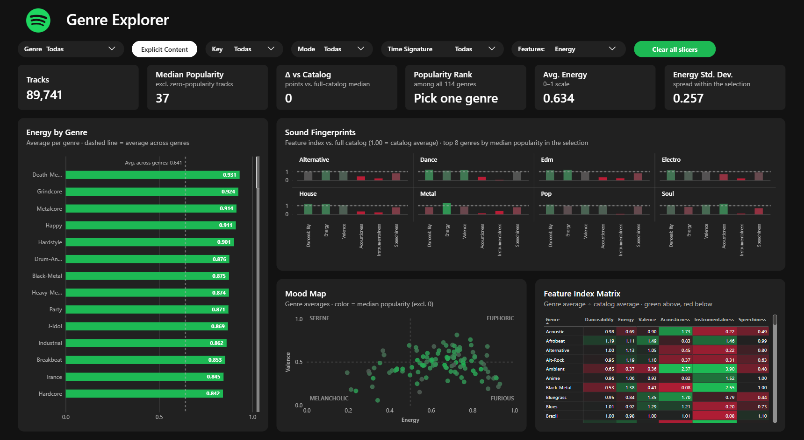
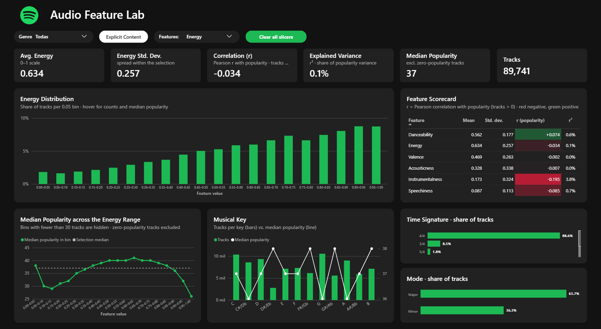
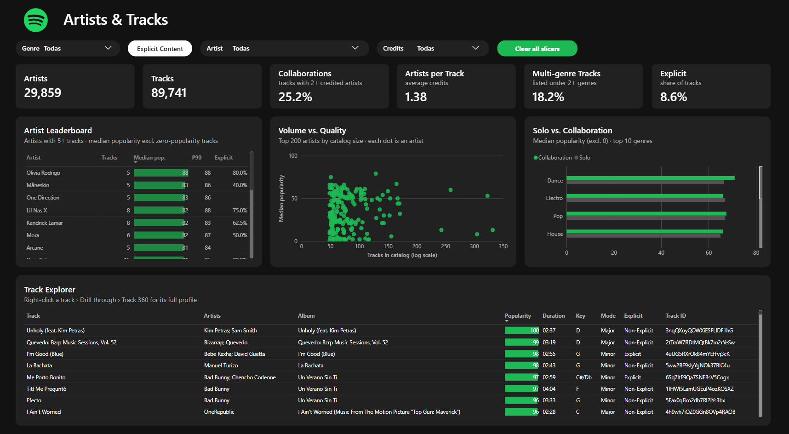
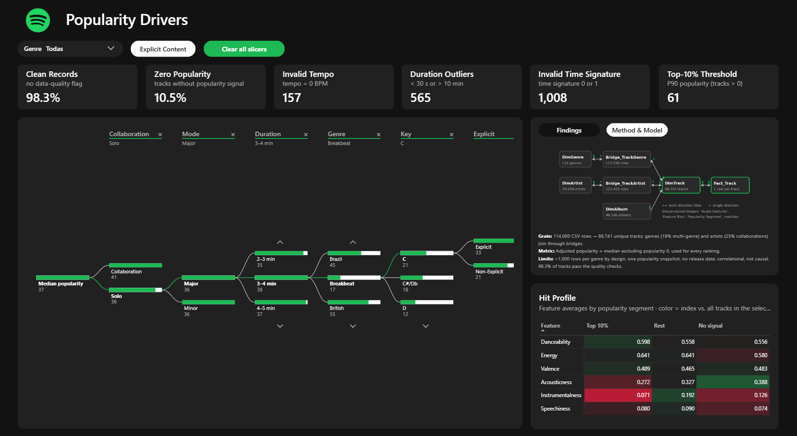
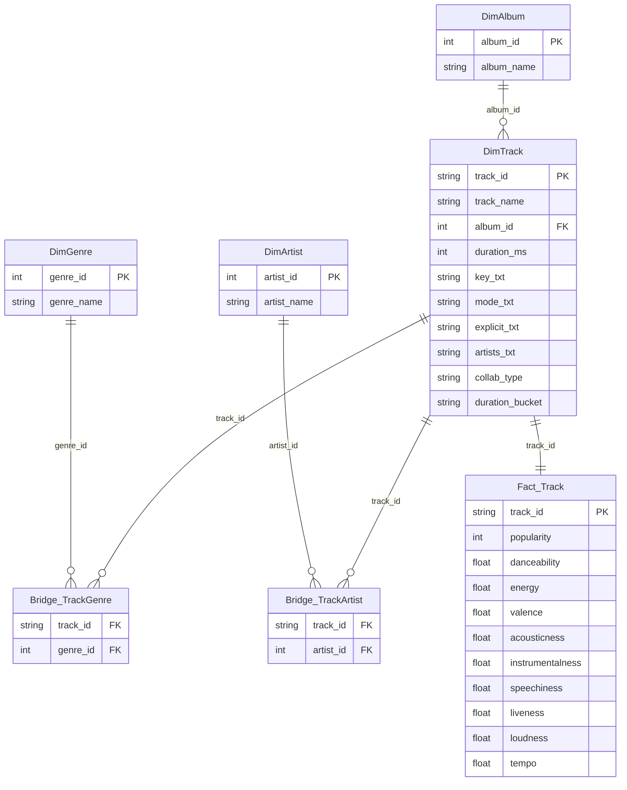

# Spotify Tracks Dashboard · Power BI


A five-page Power BI report built on the Spotify Tracks Dataset: 114,000 rows covering 89,741 unique tracks across 114 genres. It looks at how genre, audio features, collaborations and track length relate to popularity, and at what the data can and cannot support. I built it as a portfolio project for BI roles in the music industry.



## Key findings

These figures cover the full catalog of 89,741 unique tracks. "Median popularity" excludes tracks with popularity 0 ([why](#data-quality-and-limitations)).

1. **Zero popularity is a coverage gap, not a verdict.** 10.5% of tracks score 0. They are concentrated in Jazz (68%), Iranian (66%), Romance and Soul (61%). Excluding them moves Dance from a median of 1 to 69, the highest of any genre.
2. **No single audio feature explains popularity.** Instrumentalness is the strongest linear signal (r = −0.19, r² ≈ 4%). The other five features stay below |r| = 0.09.
3. **Hits are more vocal and less acoustic.** The top 10% of tracks (popularity ≥ 61) are 59% less instrumental and 17% less acoustic than the catalog average, and 6% more danceable.
4. **Collaborations and explicit tracks score higher.** Collaborations have a median of 41 against 36 for solo tracks. Explicit tracks have 41 against 37.
5. **Length has a sweet spot.** Tracks of 3–4 minutes have the highest median (40). Under 2 minutes or over 7, it drops to 27.

These are correlations from a single snapshot, not causal effects.

## Report pages

| Page | Question it answers | Main visuals |
|---|---|---|
| **Overview** | What is in the catalog, and how far can popularity be trusted? | KPI cards, top 10 genres by median popularity, popularity distribution, catalog gaps (share of zero-popularity tracks per genre), sampling-design treemap, audio profile radar with a feature glossary behind an ⓘ button |
| **Genre Explorer** | How do genres differ in sound? | Feature selector, all 114 genres ranked by the selected feature, "Sound Fingerprints" small multiples (feature index vs. catalog), energy × valence "Mood Map", genre × feature index matrix |
| **Audio Feature Lab** | How is each feature distributed, and does it relate to popularity? | 20-bin histogram, feature scorecard (mean, std. dev., Pearson r, r²), median popularity across the feature range, musical key, time signature and mode |
| **Artists & Tracks** | Who builds the catalog? | Artist leaderboard (5+ tracks), volume vs. quality scatter (log scale), solo vs. collaboration by genre, track explorer |
| **Popularity Drivers** | What can and cannot be claimed? | Data-quality KPIs, decomposition tree pre-expanded along the highest-popularity path (collaboration › explicit › length), hit profile (top 10% vs. rest vs. no signal), findings and method panel |

There are also two hidden pages:

- **Track 360** is a drill-through page. Right-click a track in the track explorer to open it. It shows the track's genres and credits, its popularity percentile within its genres, and its audio profile against the genre average.
- **Genre Tooltip** is a report-page tooltip that appears when you hover over genre-level visuals: the genre bar charts, the treemap and the Mood Map.

Interactivity:

- A page navigator on every page.
- A genre slicer synced across the five pages, and a feature selector synced between Genre Explorer and Audio Feature Lab.
- An "Explicit Content" toggle built with bookmarks.
- Titles and subtitles driven by measures. A warning appears when the selection drops below 30 tracks.

<table>
  <tr>
    <td></td>
    <td></td>
  </tr>
  <tr>
    <td></td>
    <td></td>
  </tr>
</table>

## Data model



Design decisions:

- **One row per track.** The CSV lists the same track under several genres, so its 114,000 rows reduce to 89,741 tracks. `Fact_Track` and `DimTrack` are de-duplicated by `track_id`; without that, averages would be weighted toward multi-genre tracks.
- **Many-to-many through bridges.** 18.2% of tracks belong to two or more genres. 25.2% credit more than one artist; the `artists` field is split on `;`. Both bridges are kept instead of forcing one genre or one artist per track.
- **Filter direction.** The bridges filter in both directions, so a genre selection reaches artists and an artist selection reaches genres. The model is a tree, with exactly one path between any two tables, so this adds no ambiguity. `DimTrack` ↔ `Fact_Track` is 1:1. `DimAlbum` → `DimTrack` filters in one direction only.
- **Disconnected helper tables.** `Audio Features` drives the feature selector and the parametrised measures. `Feature Bins` drives the histograms. `Popularity Segment` defines Top 10% / Rest / No signal.
- **No date dimension.** The dataset has no release date, so the report is a cross-sectional catalog analysis with no time intelligence.
- **No context transition in calculated columns.** `artists_txt` is built with `FILTER` + `RELATED` instead of `CALCULATE`, and `collab_type` is derived from it. This rules out circular dependencies between columns.

## DAX highlights

The 65 measures are grouped in display folders and each one has a description. Dynamic titles and labels use the `_TXT_` prefix.

**Adjusted popularity.** A popularity of 0 means there is no signal, not that demand is low. This median drives every ranking in the report.

```dax
adjusted_popularity =
CALCULATE ( [median_popularity], KEEPFILTERS ( Fact_Track[popularity] > 0 ) )
```

**Feature index against the full catalog.** `REMOVEFILTERS()` also clears the `Audio Features` row, so the feature is re-applied with `TREATAS`. Without it, the denominator ends up blank.

```dax
feature_index =
VAR _Feature = [_selected_feature]
VAR _Catalog =
    CALCULATE (
        [audio_feature_value],
        REMOVEFILTERS (),
        TREATAS ( { _Feature }, 'Audio Features'[Feature] )
    )
RETURN
    DIVIDE ( [audio_feature_value], _Catalog )
```

**Pearson correlation in DAX.** It is computed track by track over tracks with popularity > 0, using a two-pass formula for numerical stability. It returns blank below 30 tracks.

```dax
feature_vs_popularity =
VAR _Feature = [_selected_feature]
VAR _Base =
    SELECTCOLUMNS (
        FILTER ( Fact_Track, Fact_Track[popularity] > 0 ),
        "@x", SWITCH ( _Feature,
                  "Danceability", Fact_Track[danceability],
                  "Energy", Fact_Track[energy],
                  -- ... one branch per audio feature
                  "Speechiness", Fact_Track[speechiness] ),
        "@y", Fact_Track[popularity]
    )
VAR _N = COUNTROWS ( _Base )
VAR _MeanX = AVERAGEX ( _Base, [@x] )
VAR _MeanY = AVERAGEX ( _Base, [@y] )
VAR _Cov = SUMX ( _Base, ( [@x] - _MeanX ) * ( [@y] - _MeanY ) )
VAR _SSX = SUMX ( _Base, ( [@x] - _MeanX ) ^ 2 )
VAR _SSY = SUMX ( _Base, ( [@y] - _MeanY ) ^ 2 )
RETURN
    IF ( _N >= 30, DIVIDE ( _Cov, SQRT ( _SSX * _SSY ) ) )
```

Other patterns in the model:

- Segment measures recompute the top-10% threshold (P90 of non-zero popularity) for the current selection.
- Genre benchmarks for the drill-through page use `TREATAS` over the track's own genres.
- A data-quality count is built with `UNION` + `DISTINCT`, so a track with several flags is counted once.

## Data preparation (Power Query)

1. `Spotify_Raw` is a staging query, not loaded to the model. It reads the CSV, sets types, drops the row with no artist and removes exact duplicate rows.
2. `DimGenre`, `DimArtist` and `DimAlbum` get integer surrogate keys. Artists are split on `;` and trimmed, and genre names are title-cased.
3. The bridges store distinct track–genre and track–artist pairs.
4. `DimTrack` and `Fact_Track` are de-duplicated by `track_id`. `DimTrack` takes `album_id` from a merge with `DimAlbum`.

## Data quality and limitations

- **Zero popularity.** 10.5% of tracks have popularity 0, mostly in a handful of genres. The report treats them as missing signal: adjusted metrics exclude them, and their share is shown on every relevant page.
- **Balanced sampling.** The dataset holds about 1,000 rows per genre by design, so track counts per genre say nothing about demand. No visual ranks genres by count.
- **One snapshot.** There is no release date and no popularity history, so there are no trends and every finding is correlational.
- **Flagged, not removed.** 157 tracks have a tempo of 0, 565 last under 30 seconds or over 10 minutes, and 1,008 have an invalid time signature. 98.3% of tracks pass all checks.

## Project structure

The project is saved as a Power BI Project (PBIP), with the report in PBIR format and the semantic model in TMDL. Both are plain text and diff cleanly in Git.

```
├── Dashboard Spotify.pbip                 # open this file in Power BI Desktop
├── Dashboard Spotify.Report/              # report definition: pages, visuals, bookmarks, theme
├── Dashboard Spotify.SemanticModel/       # semantic model: tables, measures, relationships (TMDL)
├── docs/screenshots/         # images used in this README
├── .gitignore
└── README.md
```

The `.gitignore` keeps the local data cache (`.pbi/cache.abf`) and machine-specific settings (`.pbi/localSettings.json`) out of the repository, so refresh the model after cloning.

## Getting started

1. Install a recent version of Power BI Desktop. The project was built with the 2026 releases in PBIR format, and older versions may not open it.
2. Download the dataset from Kaggle (link below). The model expects 20 columns that start with `track_id`. The Kaggle file has an extra unnamed index column first, so delete it before loading or adjust the `Spotify_Raw` query.
3. Open `Dashboard Spotify.pbip`. Go to **Transform data → Spotify_Raw → Source** and point the path to your CSV. Then click **Close & Apply**.
4. Click **Refresh**. The report uses two AppSource visuals, Radar Chart and HTML Content, which load the first time it opens.

## Dataset and credits

- Data: [🎹 Spotify Tracks Dataset](https://www.kaggle.com/datasets/saichaitanyareddyai/spotify-tracks-dataset-audio-features) by Sai Chaitanya Reddy on Kaggle. 
- Audio features (danceability, energy, valence, …) are the values Spotify's Web API provided when the data was collected.

> This is an independent portfolio project. It is not affiliated with, endorsed by or sponsored by Spotify. Spotify and the Spotify logo are trademarks of Spotify AB.

## Author

**Jesús Huerta Aguilar (Planisphere)**
[LinkedIn](https://www.linkedin.com/in/jesushuertaaguilar) · [GitHub](https://github.com/planizzphere/)
